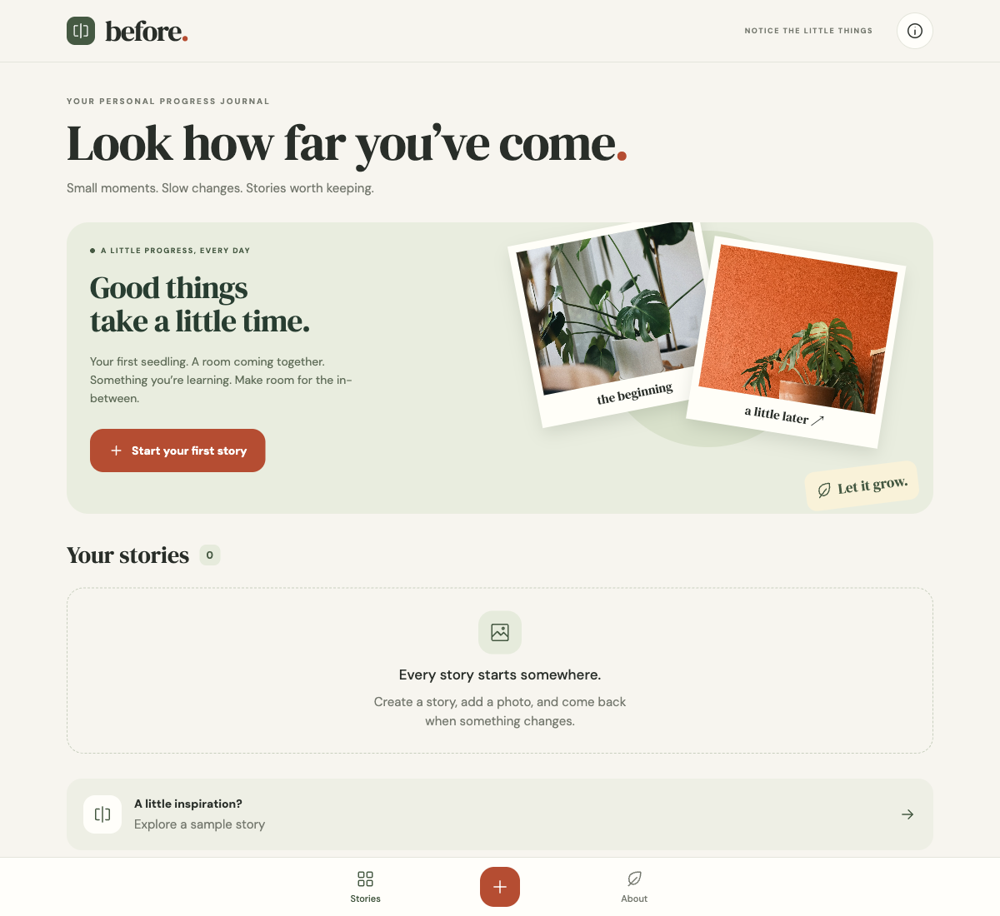
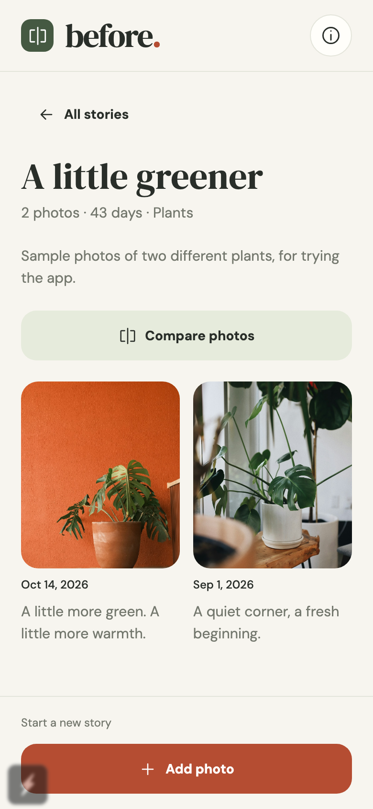
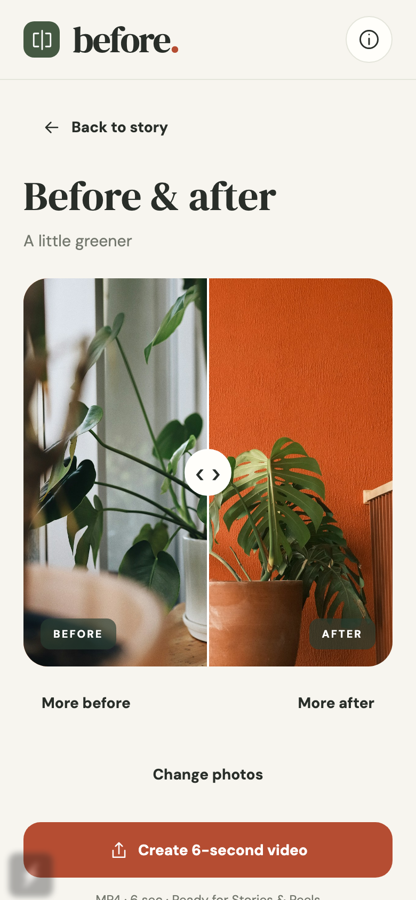

# frameago.

**Small moments. Visible progress.**

An offline photo journal for the things you’re growing, making, and becoming. Take a photo and compare how things change over time. No forms to fill in.

Built with **React Native, Expo SDK 57, Expo Router, and TypeScript** for iOS, Android, and a browser preview.






## First working slice

- Start a story with a photo: an automatic name and today’s date, with no required typing. Camera/library actions stay at the bottom while you scroll.
- Take photos on iOS and Android or import from the system library; each photo saves immediately.
- Tap a photo to optionally edit its date or note. Rename stories and choose from five categories in story details; search by name or category.
- Browse a compact photo gallery, with the latest first.
- Compare any two moments with a draggable before/after divider and accessible adjustment buttons.
- Export a side-by-side PNG using native sharing or a browser download.
- Create a six-second vertical MP4 with an animated before/after slider, preview it, then save to Photos or share. Encoding happens on the device.
- Delete individual moments or whole stories with confirmation.
- Explore a bundled sample without adding demo data to your journal.
- Keep everything on the device, with no account, analytics, or backend.

This is an early **0.1.0 implementation**, not a store release. Native permission flows, native sharing, device accessibility, and signed binaries still need device testing before TestFlight or Google Play.

## Run locally

Use Node 24 (at least 24.3) and npm. The lockfile is committed.

```sh
nvm use
npm ci
npm start
```

Open the project in a compatible Expo Go client, or use the following commands:

```sh
npm run web       # Browser preview
npm run ios       # iOS simulator (macOS/Xcode)
npm run android   # Android emulator
```

No API keys or environment variables are required. Tap **Take photo** or **Library** (**Add photo** on web) to start with your own photo, or choose **Explore a sample story**.

## Checks

```sh
npm run check                     # ESLint + TypeScript + domain tests
npx playwright install chromium webkit  # Once per machine
npm run test:e2e                   # Browser flow and persistence tests
npx expo-doctor
npx expo export --platform all    # Bundle iOS, Android, and web JavaScript
```

The browser suite covers creating and extending stories without typing, optional date/note/title/category edits, search, cancellation without empty stories, persistence across reloads, dragging the comparison divider, PNG dimensions, deletion, and retrying/discarding failed photo saves without duplicates. Video tests in Chromium and WebKit create, play and download a real six-second 1080 × 1920 H.264 MP4, and cover cancellation. GitHub Actions runs Chromium and JS bundle checks on Linux, and WebKit video checks on macOS, as [recommended by Playwright for Safari media playback](https://playwright.dev/docs/browsers#webkit). A JS export is not a signed native build.

## How it works

- `src/app/`: Expo Router routes and native stack navigation.
- `App.tsx`: application shell, editors, and save-before-update mutations.
- `src/JournalProvider.tsx`: shared journal state across routes.
- `src/domain.ts`: versioned journal model, validation, date ordering, and sample data.
- `src/storage.ts` / `storage.web.ts`: AsyncStorage metadata on native; IndexedDB in the browser.
- `src/media.ts` / `media.web.ts`: image resizing and durable storage. Native photos use paths relative to the app’s document directory so container paths can change safely. Browser photos are JPEG data URLs in IndexedDB.
- `src/components/Comparison.tsx`: swipe comparison with keyboard-accessible adjustment buttons.
- `src/export.ts` / `export.web.ts`: native capture/share and browser canvas export.
- `src/video/`: offline canvas/WebAssembly video renderer, export preview, native Photos/share and browser download. See [video export notes](docs/VIDEO-EXPORT.md) for architecture, regeneration and device checks.
- `src/screens/`: story collection, journal, and comparison views.

Photos are normalized to JPEG with a maximum dimension of 1,600 px. Native images are copied out of the picker cache. Metadata is committed before the UI reports success; invalid stored data is never silently replaced with an empty journal. Browser storage is intended for preview and can be cleared by the browser.

## Privacy and data

Photos and notes stay in app storage. There is no cloud sync or full journal backup yet. Removing the app or clearing browser data can remove the journal. Exported images/videos are not restorable journal backups. OS-managed backups are controlled by device settings.

Deleting a story removes its metadata and attempts to remove its app-owned image files; original photo-library files are untouched. A full offline web install/service worker is not included. The native app bundles its sample photos and fonts.

## Toward the stores

See [the TestFlight steps and release checklist](docs/RELEASE.md) for the next milestones. The project is linked to [@pavel667/before on EAS](https://expo.dev/accounts/pavel667/projects/before). The `production` profile builds a signed store binary with Node 24 and an SDK 57 iOS build image, with build numbers managed by EAS. Apple Developer membership is active and the first signed build is complete; see the release checklist for submission status. The display name is now Frameago. Existing service identifiers and storage keys retain `before` for continuity. The bundle ID is `com.a1231231123bc.before`.

## Dependency audit

The initial dependency audit reports upstream advisories in `braces`, `decode-uri-component`, `node-forge`, and `uuid`, propagated through the Expo/Metro/Xcode tooling and routing dependencies. Compatible fixes were applied where available; the audit still reports 31 affected dependency entries. npm proposes incompatible framework downgrades for the remaining items, so `npm audit fix --force` has not been used. Review these advisories and patched SDK/tooling releases before distribution; passing the app checks does not mean the dependency audit is clean.

## Credits

Sample photographs are bundled for offline demonstration under the [Unsplash License](https://unsplash.com/license):

- [Josh Duke — plant in a white ceramic pot](https://unsplash.com/photos/DHhuqwyjSuo)
- [Febri Adiawarja — plant in a terracotta pot](https://unsplash.com/photos/TSKYvXf1d4M)

They show different plants, not an actual before/after transformation. This is stated in the sample story.

DM Sans and DM Serif Display are distributed under the SIL Open Font License; license files are included in `docs/licenses/`. `assets/brand.svg` is the app’s editable vector icon source.

Video encoding uses h264-mp4-encoder (MIT), minih264 (CC0), and libmp4v2 (MPL 1.1). [Licenses and source](docs/VIDEO-EXPORT.md#licenses-and-source).
